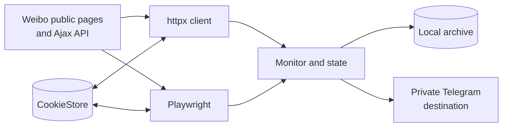

<p align="center">
  
</p>

<h1 align="center">Weibo Monitor</h1>

<p align="center">
  A privacy-conscious, self-hosted monitor for public Weibo updates, screenshots, media archives, and Telegram notifications.
</p>

<p align="center">
  <a href="https://github.com/SeaL773/weibo-monitor-oss/actions/workflows/ci.yml"></a>
  <a href="https://github.com/SeaL773/weibo-monitor-oss/actions/workflows/secret-scan.yml"></a>
  <a href="https://www.python.org/"></a>
  <a href="https://www.docker.com/"></a>
  <a href="LICENSE"></a>
</p>

<p align="center">
  <a href="#features">Features</a> ·
  <a href="#installation">Installation</a> ·
  <a href="#configuration">Configuration</a> ·
  <a href="#cookie-lifecycle-and-security">Cookie security</a> ·
  <a href="#testing">Testing</a>
</p>

> [!IMPORTANT]
> This is an independent, unofficial project and is not affiliated with, endorsed by, or sponsored by Weibo, Sina, or Telegram. Weibo and Telegram names and trademarks belong to their respective owners. Use the software only for public content that you are permitted to access, and comply with applicable platform terms, laws, copyright, privacy, and rate limits.

## Features

| Persistent session | Browser captures | Private delivery |
|---|---|---|
| Shared CookieStore for httpx and Playwright, including rotated-cookie persistence and periodic first-party refresh | Mobile-viewport Playwright screenshots plus bounded image and video archiving | Telegram notifications, with Pyrogram support for files of at least 50 MB |

- Detect original posts, reposts, comments with pictures, profile changes, and follow-list changes.
- Archive existing post IDs silently or send existing posts on the first run.
- Persist local state across container rebuilds without placing credentials in the image.

## Architecture



## Requirements

- Docker Engine with Docker Compose v2
- A Weibo account that can access the monitored public pages
- A Telegram bot and a private chat/channel for notifications
- Optional Telegram API credentials for large-file uploads through Pyrogram

Use a dedicated, least-privileged Weibo account when possible. Do not monitor private, restricted, or otherwise unauthorized content. Keep the destination Telegram chat private if notifications may contain personal information.

## Installation

1. Clone the repository and create the local configuration:

   ```bash
   git clone https://github.com/SeaL773/weibo-monitor-oss.git
   cd weibo-monitor-oss
   cp .env.example .env
   ```

2. Edit `.env`:

   ```dotenv
   WEIBO_COOKIES=[{"name":"SUB","value":"...","domain":".weibo.com","path":"/","secure":true,"httpOnly":true}]
   WEIBO_TARGETS=1234567,7654321
   USER_TAGS=1234567:UserA,7654321:UserB
   TG_BOT_TOKEN=TOKEN
   TG_CHAT_ID=CHAT_ID
   POLL_INTERVAL=300
   COOKIE_REFRESH_INTERVAL=21600
   FIRST_RUN_MODE=archive
   ```

   Export the complete `weibo.com` cookie set from a browser session that you control. `WEIBO_TARGETS` is a comma-separated list of numeric Weibo UIDs. Labels are configured separately through optional `USER_TAGS` entries in `uid:label` form. Labels must not be appended to `WEIBO_TARGETS`.

3. Build and start the service:

   ```bash
   # Linux bind mounts must be writable by the container user (UID/GID 10001).
   mkdir -p data
   sudo chown -R 10001:10001 data
   docker compose up -d --build
   docker compose logs -f --tail=100
   ```

   On Docker Desktop for Windows or macOS, create `data/` normally; the Linux ownership command is typically unnecessary.

The first start can take several minutes while Chromium is installed. Runtime state is stored under `./data` and survives container recreation.

## Configuration

| Variable | Description | Default |
|---|---|---|
| `TG_BOT_TOKEN` | Telegram Bot API token | required |
| `TG_BOT_TOKEN_FILE` | File containing the Telegram bot token; takes precedence over `TG_BOT_TOKEN` | optional |
| `TG_CHAT_ID` | Private Telegram chat/channel ID | required |
| `TG_API_ID` | Telegram API ID used by Pyrogram | optional |
| `TG_API_HASH` | Telegram API hash used by Pyrogram | optional |
| `TG_API_HASH_FILE` | File containing the Telegram API hash | optional |
| `WEIBO_COOKIES` | Initial browser cookie export; used only when persistent state is empty | required on first boot |
| `WEIBO_COOKIES_FILE` | File containing the initial cookie JSON | optional |
| `WEIBO_TARGETS` | Comma-separated Weibo UIDs, such as `1234567,7654321` | required |
| `USER_TAGS` | Optional comma-separated `uid:label` mappings | empty |
| `POLL_INTERVAL` | Base polling interval in seconds; the app adds jitter | `300` |
| `FOLLOW_CHECK_INTERVAL` | Follow-list check interval in seconds | `1800` |
| `COOKIE_REFRESH_INTERVAL` | First-party homepage session-refresh interval in seconds | `21600` |
| `MAX_IMAGE_BYTES` | Maximum archived image size in bytes | `20971520` |
| `MAX_VIDEO_BYTES` | Maximum downloaded video size in bytes | `524288000` |
| `FIRST_RUN_MODE` | `archive` records existing post IDs; `push` sends existing posts | `archive` |

## Cookie lifecycle and security

On first boot, the monitor imports `WEIBO_COOKIES` into `data/auth_state.json`. The persistent file then becomes authoritative:

- httpx saves server-side cookie rotations and updates `X-XSRF-TOKEN`.
- Playwright loads the shared cookie state, saves changes before context rotation, and periodically visits a first-party Weibo page.
- The `./data:/app/data` volume retains authentication state across rebuilds.
- Cookie values should not appear in normal application logs.

Cookies are credentials and are stored **unencrypted at rest** in `.env` and `data/auth_state.json`. Never commit, paste into issues, include in Docker images, or share these files. Restrict host access to the project directory and backups. File mode `0600` is attempted for the persistent store, but permissions on Windows bind mounts depend on Windows ACLs; protect the directory with an ACL and full-disk encryption. Rotate the Weibo session immediately if a cookie may have leaked.

To replace an expired session:

```bash
docker compose stop
mv data/auth_state.json data/auth_state.json.bak
# Replace WEIBO_COOKIES in .env, then:
docker compose up -d --build --force-recreate
```

After confirming the new session works, securely delete the backup. A plain `docker restart` does not reload `.env`.

## Upgrade

Back up `.env` and `data/`, review release notes and configuration changes, then rebuild from the updated source:

```bash
docker compose stop
git pull --ff-only
docker compose up -d --build --force-recreate
docker compose logs --tail=100
```

## Testing

The cookie-state tests do not contact Weibo or Telegram:

```bash
python -m unittest discover -v -p "test_*.py"
docker compose config
```

Any manual/live push test can contact Weibo and send a real Telegram message. Run live tests only with dedicated test accounts and an explicit live-test opt-in documented by the script; they are not part of the default test suite.

```bash
RUN_LIVE_TESTS=1 python scripts/manual_push_test.py
```

## Data, privacy, and retention

The service can retain post IDs, profile/follow metadata, comments, downloaded media, screenshots, logs, Telegram/Pyrogram session data, and authentication cookies. Operators are responsible for providing any required notice, choosing an appropriate lawful basis, minimizing collection, and honoring deletion or access requests. Content remains owned by its original rightsholders; this license does not grant rights to Weibo content or third-party media.

Choose a retention period appropriate for your use and periodically delete unneeded files from `data/`, Docker logs, backups, and the Telegram destination. Stopping or removing a container does not delete bind-mounted data or messages already delivered to Telegram.

Versions before the unified CookieStore may have created `data/cookies_runtime.json`.
After confirming `data/auth_state.json` works, delete the obsolete runtime file.

To uninstall while preserving data:

```bash
docker compose down --remove-orphans
```

To erase local runtime data, first run the command above, then delete the project's `data/` directory and `.env` using your platform's secure deletion or recycle-bin workflow. Delete corresponding Telegram messages separately.

## Project structure

```text
weibo-monitor/
├── src/
│   ├── api/                  # Weibo clients and cookie state
│   ├── archive/              # State and media persistence
│   ├── core/                 # Monitoring and notification logic
│   ├── screenshot/           # Playwright screenshot capture
│   └── telegram/             # Bot API and Pyrogram transports
├── data/                     # Local runtime data; not version-controlled
├── docker-compose.yml
├── Dockerfile
└── requirements.txt
```

## Security and contributing

See [SECURITY.md](SECURITY.md) for private vulnerability reporting and [CONTRIBUTING.md](CONTRIBUTING.md) for development guidelines. Dependency license information is summarized in [THIRD_PARTY_NOTICES.md](THIRD_PARTY_NOTICES.md).

## License

The source code is licensed under the [MIT License](LICENSE). This license applies only to this project's source code, not to monitored content, screenshots, downloaded media, platform APIs, trademarks, or third-party components.
