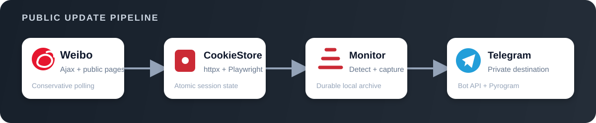
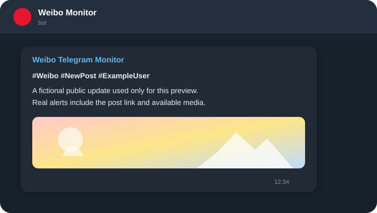

<div align="center">
  <table>
    <tr>
      <td bgcolor="#242d38" align="center" width="390">
        <a href="https://weibo.com/">
          
        </a>
      </td>
    </tr>
  </table>
  <h1>Unofficial Weibo → Telegram Monitor</h1>
  <p><strong>Durable public-post monitoring, persistent browser sessions, and private Telegram delivery.</strong></p>
  <p>
    
    
    
    
  </p>
</div>



This headless monitor polls Weibo's desktop Ajax API, captures mobile-layout
screenshots with Playwright, and sends public-post updates to a private Telegram
destination. A shared CookieStore synchronizes httpx and Playwright, persists
normal server-side cookie rotation, and restores the session after container
recreation. Post, comment, profile, and follow-list changes are tracked with
bounded local media downloads and optional Pyrogram transport for large videos.

> **Not affiliated with Weibo, Sina, Telegram, or any browser-extension provider.**
> This independent client reads public pages that the configured account is
> permitted to access; it does not publish back to Weibo. You are responsible
> for complying with every connected service's terms, privacy rules, copyright
> restrictions, and rate limits.
>
> Weibo and its marks are trademarks of their respective owner. The Sina Weibo
> icon above is sourced from Simple Icons 16.28.0 and is used only to identify
> the service this client connects to; its use does not imply affiliation or
> endorsement. See the [Weibo Community Convention](https://weibo.com/signup/v5/protocol).

## Contents

- [Features](#features)
- [Preview](#preview)
- [How it works](#how-it-works)
- [Reliability model](#reliability-model)
- [Quick start](#quick-start)
- [Configuration](#configuration)
- [Cookie and session lifecycle](#cookie-and-session-lifecycle)
- [Project layout](#project-layout)
- [Testing](#testing)
- [Security and privacy](#security-and-privacy)
- [Limitations](#limitations)
- [Troubleshooting](#troubleshooting)
- [Project status](#project-status)
- [License](#license)

## Features

- **Post detection**: polls the desktop Ajax API with jitter, detects original
  posts and reposts, and maintains a bounded seen-ID history per target.
- **Screenshot capture**: uses a mobile Playwright context for clean post
  screenshots while sharing the same persistent authentication state as httpx.
- **Durable state**: stores seen IDs, profile/follow metadata, active comment
  watches, screenshots, and accepted media under the bind-mounted `data/` tree.
- **Cookie rotation**: imports a browser cookie export once, persists normal
  `Set-Cookie` updates, refreshes `X-XSRF-TOKEN`, and periodically visits a
  first-party Weibo page to retain browser-side rotation.
- **Change tracking**: detects comments with pictures, profile edits, new
  follows, and unfollows in addition to new posts.
- **Telegram delivery**: sends formatted text, photos, GIFs, screenshots, and
  video alerts to a private chat or channel through the Bot API.
- **Large media transport**: uses Pyrogram when configured for videos of at
  least 50 MB, with FFmpeg-derived metadata and thumbnails.
- **Built-in liveness monitoring**: an internal watchdog and Docker healthcheck
  observe `/tmp/healthcheck`, while repeated cycle failures trigger backoff.

Failures are isolated by target and stage where practical: one target, profile
check, follow check, comment poll, screenshot, or media download can fail
without terminating the long-running monitor process.

## Preview

<div align="center">
  
</div>

The preview is generated for this repository and uses fictional content. Real
messages can contain the target label, change type, public post URL, screenshot,
and available media returned by Weibo.

## How it works

| Stage | Responsibility |
|---|---|
| Target polling | Requests each configured UID from the desktop Ajax API with per-cycle jitter and failure isolation |
| Cookie store | Shares allowlisted Weibo/Sina cookies between httpx and Playwright and persists rotation atomically |
| Change detection | Compares posts, comments, profile fields, and follow lists with durable local state |
| Playwright | Visits first-party pages for screenshots and periodic browser-session refresh |
| Local archive | Saves JSON metadata, screenshots, and size-bounded media under `data/` |
| Telegram | Delivers alerts through the Bot API and optionally uploads large video through Pyrogram |

### Session refresh flow

1. On the first boot, the monitor imports `WEIBO_COOKIES` or
   `WEIBO_COOKIES_FILE` into `data/auth_state.json`.
2. Every httpx response can replace the shared jar with accepted `Set-Cookie`
   rotation and update the current XSRF header.
3. Playwright loads the shared records, periodically visits a first-party
   Weibo page, and merges browser-side changes before context rotation.
4. Cookie updates are written through a temporary file and atomic replace;
   the persistent file becomes authoritative on later boots.

## Reliability model

- **Polling layer**: each target is checked independently, the interval includes
  jitter, and repeated outer-cycle failures use exponential backoff capped at
  one hour.
- **Session layer**: httpx and Playwright use one CookieStore so rotation is not
  lost between transports or container recreations.
- **State layer**: seen IDs and change-tracking metadata are persisted during a
  cycle, while media downloads are streamed and capped rather than held fully
  in memory.
- **Delivery layer**: text, screenshots, media, and large-video transport have
  separate failure paths so an optional attachment does not stop later polls.
- **Liveness signal**: the monitor updates `/tmp/healthcheck`; Docker marks the
  container unhealthy when the heartbeat becomes stale.

This is a best-effort reliability design, not a formal SLA. It has not been
load-tested against platform-wide outages, account challenges, or aggressive
provider-side rate limiting.

## Quick start

### Prerequisites

- Docker Engine with Docker Compose v2
- A Weibo account that can access the public pages being monitored
- A complete `weibo.com` browser cookie export from a session you control
- A Telegram bot token and private target chat/channel ID

Optional Telegram API credentials enable Pyrogram transport for large videos.

### Run

```bash
git clone https://github.com/SeaL773/weibo-telegram-monitor.git
cd weibo-telegram-monitor
cp .env.example .env
# Fill in Weibo targets/cookies and Telegram credentials.

# Linux only: the non-root container runs as UID/GID 10001.
mkdir -p data
sudo chown -R 10001:10001 data

docker compose up -d --build
docker compose logs -f --tail=100
```

Docker Desktop users normally do not need the ownership command. The default
`FIRST_RUN_MODE=archive` records existing post IDs without sending historical
posts; it does not download every historical post. The initial cookie export is
used only when persistent cookie state is empty.

## Configuration

All configuration is supplied through environment variables; see
[`.env.example`](.env.example).

### Core

| Variable | Required | Default | Description |
|---|---:|---|---|
| `WEIBO_TARGETS` | yes | n/a | Comma-separated numeric Weibo UIDs, such as `1234567,7654321` |
| `USER_TAGS` | no | empty | Separate comma-separated `uid:label` mappings used in alert hashtags |
| `TG_BOT_TOKEN` | yes | n/a | Telegram Bot API token |
| `TG_BOT_TOKEN_FILE` | no | empty | File containing the bot token; takes precedence over `TG_BOT_TOKEN` |
| `TG_CHAT_ID` | yes | n/a | Private Telegram chat or channel ID |
| `FIRST_RUN_MODE` | no | `archive` | `archive` records existing IDs silently; `push` sends existing posts |

### Session and polling

| Variable | Required | Default | Description |
|---|---:|---|---|
| `WEIBO_COOKIES` | first boot | `[]` | Initial browser cookie export as a JSON list or name/value object |
| `WEIBO_COOKIES_FILE` | no | empty | File containing the initial cookie JSON; takes precedence over `WEIBO_COOKIES` |
| `POLL_INTERVAL` | no | `300` | Base post-poll interval in seconds; the app adds up to 60 seconds of jitter in either direction |
| `FOLLOW_CHECK_INTERVAL` | no | `1800` | Follow-list check interval in seconds |
| `COOKIE_REFRESH_INTERVAL` | no | `21600` | First-party browser-session refresh interval in seconds |

### Telegram and media

| Variable | Required | Default | Description |
|---|---:|---|---|
| `TG_API_ID` | no | `0` | Telegram API ID used by Pyrogram for large videos |
| `TG_API_HASH` | no | empty | Telegram API hash paired with `TG_API_ID` |
| `TG_API_HASH_FILE` | no | empty | File containing the API hash; takes precedence over `TG_API_HASH` |
| `MAX_IMAGE_BYTES` | no | `20971520` | Maximum archived image size in bytes |
| `MAX_VIDEO_BYTES` | no | `524288000` | Maximum downloaded video size in bytes |

`WEIBO_TARGETS` accepts UIDs only. Keep human-readable labels in `USER_TAGS`;
do not append labels to the target list. The download client accepts HTTPS
media only from an allowlist of Weibo/Sina CDN domains, validates redirects and
content types, and enforces both declared and streamed size limits.

## Cookie and session lifecycle

The browser export seeds `data/auth_state.json` only when that persistent file
contains no usable cookies. From then on, the persistent CookieStore wins over
the `.env` bootstrap value. This prevents an older environment export from
overwriting newer server-side rotation after every restart.

Cookies are still provider-controlled credentials. Normal first-party activity
can preserve rotations and reduce manual exports, but it cannot override an
explicit logout, password/security change, account challenge, revocation, or
platform-side expiration.

<details>
<summary><strong>Replace an expired session</strong></summary>

```bash
docker compose stop
mv data/auth_state.json data/auth_state.json.bak
# Replace WEIBO_COOKIES in .env, then recreate the service:
docker compose up -d --build --force-recreate
docker compose logs --tail=100
```

After confirming the new session works, securely delete the backup. A plain
`docker restart` does not reload `.env`.

</details>

Versions predating the unified CookieStore may have created
`data/cookies_runtime.json`. After confirming `data/auth_state.json` works,
remove the obsolete runtime file.

## Project layout

```text
weibo-telegram-monitor/
├── main.py                         # process entry point
├── Dockerfile                      # non-root Python/Chromium image
├── docker-compose.yml              # hardened long-running service
├── requirements.txt
├── .env.example
├── scripts/manual_push_test.py     # explicit opt-in live test
├── test_cookie_store.py            # offline session tests
├── test_security.py                # offline boundary tests
└── src/
    ├── api/                        # Weibo clients, parsing, CookieStore
    ├── archive/                    # state and bounded media persistence
    ├── core/                       # configuration, monitor loop, push logic
    ├── screenshot/                 # Playwright capture and session refresh
    ├── telegram/                   # Bot API and Pyrogram transports
    └── utils/                      # logging
```

## Testing

Offline tests use plain `unittest` and do not contact Weibo or Telegram:

```bash
python -m unittest discover -v -p "test_*.py"
ruff check .
docker compose config
```

Coverage includes environment bootstrap precedence, httpx and Playwright cookie
rotation, cookie-domain filtering, URL redaction, media-host validation, and
archive path boundaries. The manual push script sends a real Telegram message
and requires an explicit opt-in; it is excluded from default test discovery.

```bash
RUN_LIVE_TESTS=1 python scripts/manual_push_test.py
```

## Security and privacy

- **Treat `.env`, `data/auth_state.json`, Telegram/Pyrogram session files, and
  every Weibo or Telegram credential as secrets.** Do not paste them into
  issues, logs, screenshots, container images, or public backups.
- `.env`, `data/`, sessions, logs, and caches are excluded from Git and the
  Docker build context. If a secret enters Git history, rotate it first and
  purge the history rather than relying on a later deletion commit.
- Cookie state is unencrypted at rest. Mode `0600` is attempted on Linux;
  Windows bind mounts depend on Windows ACLs. Protect the host, backups, and
  disk, and keep the Telegram destination private.
- Runtime data can include post/profile/follow metadata, comments, screenshots,
  media, and message copies. Choose a retention period and delete unneeded data
  from `data/`, Docker logs, backups, and Telegram.
- See [SECURITY.md](SECURITY.md) for private vulnerability reporting and
  [THIRD_PARTY_NOTICES.md](THIRD_PARTY_NOTICES.md) for dependency and asset
  notices.

## Limitations

- Weibo can expire or revoke a session despite periodic first-party refresh;
  account verification or a fresh browser export may still be required.
- Desktop Ajax responses and mobile page DOM can change without notice and may
  require parser or screenshot-selector updates.
- Playwright and Chromium consume substantially more memory and image size than
  an HTTP-only monitor.
- Platform rate limits, access challenges, regional behavior, and account-level
  restrictions can interrupt polling even with jitter and backoff.
- Best-effort interval polling can miss content removed between checks, and the
  project makes no completeness or delivery guarantee.

## Troubleshooting

| Symptom | Likely cause | Where to look |
|---|---|---|
| No Telegram messages arrive | Incorrect bot token/chat ID, first-run archive mode, or no new posts | Startup logs; `TG_BOT_TOKEN`, `TG_CHAT_ID`, and `FIRST_RUN_MODE` |
| Repeated Weibo auth failures | Incomplete/revoked cookies or an account challenge | Auth warnings, `data/auth_state.json`, and the session replacement flow |
| Session works in a browser but expires in Docker | Container has stale bootstrap state or cannot persist rotation | `data/` ownership, CookieStore persistence logs, and `COOKIE_REFRESH_INTERVAL` |
| Screenshots are blank or fail | Mobile DOM changed, Chromium failed, or the account cannot open the detail page | Playwright logs, container memory, and the target post URL |
| Large video upload fails | Missing Telegram API credentials, FFmpeg failure, or media exceeds its cap | `TG_API_ID`, `TG_API_HASH`, Pyrogram logs, and `MAX_VIDEO_BYTES` |
| Container becomes unhealthy | `/tmp/healthcheck` has not advanced within the healthcheck window | Monitor-cycle logs, upstream connectivity, and Docker health output |

## Project status

Actively used for personal public-post monitoring; contributions and issue
reports are welcome, but there is no formal support commitment or SLA.

## License

Released under the [MIT License](LICENSE). The license covers this project's
source and original artwork, not Weibo content, third-party media, trademarks,
or separately licensed dependencies.
